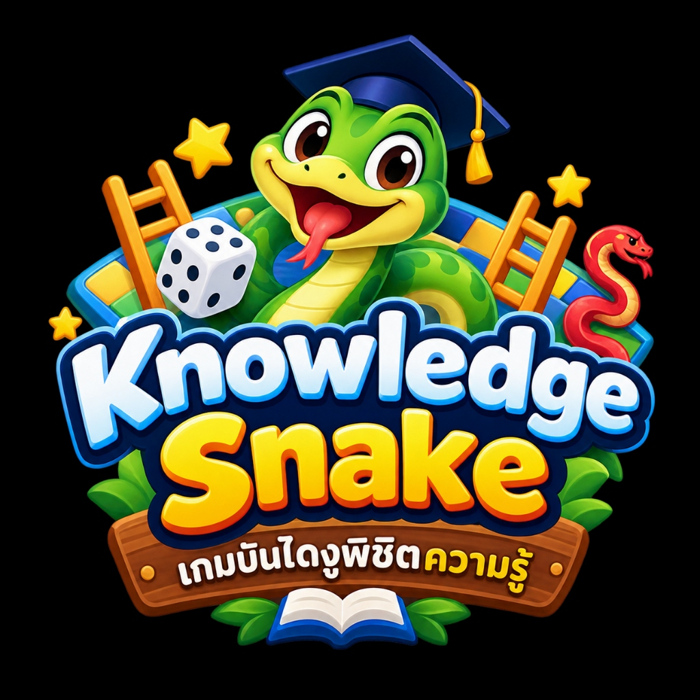

# 🐍 Knowledge Snake (เกมบันไดงูตอบคำถามพิชิตความรู้)

<p align="center">
  
</p>

<p align="center">
  <strong>แพลตฟอร์มเกมบันไดงูตอบคำถามเพื่อการเรียนรู้แบบ Interactive ในชั้นเรียน (Gamified Classroom Assessment)</strong><br />
  ผสานความตื่นเต้นของเกมกระดานบันไดงูกับการวัดและประเมินผลผู้เรียนแบบเรียลไทม์ (คล้าย Kahoot / Quizizz)
</p>

<p align="center">
  
  
  
  
  
</p>

---

## 🌟 จุดเด่นและฟีเจอร์หลัก (Key Features)

### 1. 🎲 กระดานเกม 100 ช่องแบบ 3D สมจริง (3D Fantasy Board)
* กระดานเกม 100 ช่องแบบ Boustrophedon (สลับซ้าย-ขวา) มีมิติแสงเงาแบบ 3D Bevel Tile
* **ตัวงู 3D:** ตัวงูหลากสายพันธุ์ (Emerald Cobra, Ruby Viper, Amethyst Python, Golden Adder) มีความโค้งมน แสงเงาปริมาตรทรงกระบอก เกล็ด ท้องงู และดวงตาสะท้อนแสง
* **บันได 3D:** ราวบันไดไม้เนื้อแข็งสีทองพร้อมเงาตกกระทบ ขอบนูน 3D และหมุดยึดโลหะ
* **แอนิเมชันตัวละคร:** ตัวหมากจะกระโดดเด้งดึ๋ง (Hopping Bounce) พร้อมวงแหวนประกายทองติดตามทุกก้าวที่เดิน

### 2. 🎁 ระบบไอเทมพิเศษบนกระดาน (Board Power-Ups)
เพิ่มสีสันและความสนุกด้วยไอเทมพิเศษบนช่องกระดานที่มีเอฟเฟกต์เฉพาะตัว:
* 🛡️ **ช่อง 12 — โล่วิเศษ (Shield):** เกราะป้องกัน เมื่อเดินตกหัวงู เกราะจะแตกเพื่อปกป้องผู้เล่นไม่ให้ลื่นตกลงมา 1 ครั้ง
* ⭐ **ช่อง 25 — ดาวโบนัส (Star):** ได้รับสิทธิ์ทอยลูกเต๋าเพิ่มทันที 1 ครั้ง
* 💎 **ช่อง 38 — อัญมณีมหัศจรรย์ (Gem):** รับคะแนนโบนัสพิเศษ +50 คะแนนทันที
* 🎁 **ช่อง 50 — กล่องของขวัญนำโชค (Gift):** รับพลังนำโชควาร์ปเดินหน้าเพิ่มทันที +3 ช่อง
* 🧲 **ช่อง 60 — แม่เหล็กพลังสูง (Magnet):** แม่เหล็กดูดตัวละครเดินไปยังบันไดช่อง 61 เพื่อปีนขึ้นไปช่อง 89 ทันที
* 🚀 **ช่อง 75 — จรวดบูสเตอร์ (Rocket):** จุดระเบิดไอพ่นพุ่งทะยานไปข้างหน้า +5 ช่อง
* ⚡ **ช่อง 88 — สายฟ้าพลังงาน (Boost):** เพิ่มพลังงานพร้อมสิทธิ์ทอยลูกเต๋าในรอบถัดไป

### 3. 🎯 ระบบตอบคำถามและสิทธิ์การทอยลูกเต๋า (Fair & Interactive Gameplay)
* นักเรียนตอบคำถามผ่านอุปกรณ์ของตนเอง (มือถือ/แท็บเล็ต/คอมพิวเตอร์)
* **ตอบถูก:** รับทันที +100 คะแนน พร้อมสิทธิ์ทอยลูกเต๋าเพื่อเดินตัวละครบนกระดานทันที
* **ตอบผิด:** สะสมคะแนนและรอแก้มือในข้อถัดไป

### 4. 📊 ระบบนับคะแนนและสถิติแม่นยำ (Accurate Scoring & Analytics)
* คำนวณคะแนนรวมจาก: `(จำนวนข้อที่ตอบถูก × 100) + ตำแหน่งบนกระดาน + โบนัสเส้นชัย + โบนัสไอเทมเพชร (+50)`
* บันทึกสถิติแยกตามจำนวนข้อ: **ตอบถูก (`correctCount`)**, **ตอบผิด (`wrongCount`)**, และ **ความแม่นยำ %**
* แสดงผลเรียลไทม์ทั้งบนหน้าจอผู้เล่น หน้าจอควบคุมของคุณครู และกระดานผู้นำ (Leaderboard)

### 5. 🎊 เอฟเฟกต์ภาพและเสียงประกอบ (VFX & Web Audio SFX)
* **ลูกเต๋า 3D Cube:** หมุนทอยสมจริง 6 ด้าน พร้อมคลื่นกระแทก Shockwave Ripple เมื่อลูกเต๋าตกกระทบพื้น
* **พลุกระดาษเฉลิมฉลอง (Confetti Canvas):** จุดพลุกระดาษและละอองดาวเมื่อตอบถูก ทอยได้แต้ม 6 หรือเมื่อจบเกม
* **การ์ดเหตุการณ์พิเศษ (Special Event Card):** แอนิเมชันป๊อปอัปตามชนิดของไอเทม (แสงออร่า, สนามพลังบาเรีย, ประกายเพชร, ไอพ่นจรวด)
* **ระบบเสียงสังเคราะห์ (Web Audio API):** สังเคราะห์เสียงแบบ Pure Client-side เสียงใส กริ๊บ ไม่มีดีเลย์ ไม่ต้องดาวน์โหลดไฟล์ MP3 จากภายนอก พร้อมปุ่มเปิด/ปิดเสียง 🔊/🔇

### 6. 👨‍🏫 เครื่องมืออำนวยความสะดวกสำหรับคุณครู (Teacher Suite)
* **ระบบห้องเรียน (Room Key & QR Code):** สร้างห้องเรียนด้วยรหัส 6 หลัก พร้อม QR Code ให้นักเรียนสแกนเข้าห้องได้ทันใจ
* **บันทึกห้องเรียน (Saved Rooms):** บันทึกห้องที่สร้างไว้เพื่อเปิดใช้งานซ้ำได้ตลอดเวลา ไม่ต้องสร้างใหม่ และสามารถลบได้ตามต้องการ
* **หน้าจอควบคุมเกม (Live Host Controller):** คุณครูกดเริ่มเกม, ควบคุมการเปิดคำถาม, กดเฉลย และช่วยทอยเต๋าให้นักเรียนได้
* **หน้าจอโปรเจกเตอร์ (Projector View 16:9):** หน้าจอ Read-only สำหรับฉายขึ้นทีวีหรือจอโปรเจกเตอร์หน้าห้องเรียน
* **รายงานสรุปผล (A4 Printable Reports):** ตารางรายงานผลสรุปอันดับ คะแนน สถิติตอบถูก/ตอบผิด จำนวนครั้งที่ขึ้นบันได/โดนงูกัด สามารถสั่งพิมพ์ A4 ได้ทันที

---

## 🛠️ โครงสร้างเทคโนโลยี (Tech Stack)

* **Frontend & Backend Framework:** [Next.js](https://nextjs.org/) (App Router, Server Actions, Route Handlers)
* **Language:** [TypeScript](https://www.typescriptlang.org/)
* **Styling & UI:** [Tailwind CSS](https://tailwindcss.com/), Lucide Icons
* **Realtime State Management:** State Synchronizer with BroadcastChannel & Polling Transport
* **Graphics & Visuals:** HTML5 Canvas Confetti, CSS 3D Transforms, SVG Filters & Gradients
* **Audio Synthesis:** Native Browser Web Audio API (Sine, Triangle, Sawtooth Oscillators)

---

## 📁 โครงสร้างโปรเจกต์ (Project Structure)

```text
├── app/
│   ├── page.tsx                     # หน้าหลัก (Landing Page)
│   ├── join/page.tsx                # หน้านักเรียนกรอก PIN และเลือก Avatar เข้าร่วมเกม
│   ├── game/[pin]/
│   │   ├── play/page.tsx            # หน้าจอการเล่นของนักเรียน (กระดาน + คำถาม + ลูกเต๋า)
│   │   └── projector/page.tsx       # หน้าจอสำหรับฉายขึ้นจอโปรเจกเตอร์หน้าห้อง (16:9)
│   ├── teacher/
│   │   ├── login/page.tsx           # หน้าเข้าสู่ระบบครูผู้สอน
│   │   ├── register/page.tsx        # หน้าสมัครสมาชิกครูผู้สอน
│   │   ├── dashboard/page.tsx       # แดชบอร์ดจัดการห้องเรียนและเกมที่บันทึกไว้
│   │   ├── games/[pin]/page.tsx     # หน้าควบคุมเกมสดของคุณครู (Live Controller)
│   │   ├── games/new/page.tsx       # สร้างห้องเรียน / ชุดคำถามใหม่
│   │   ├── questions/page.tsx       # คลังข้อสอบ (Question Bank)
│   │   └── reports/page.tsx         # รายงานสถิติคะแนนผลสัมฤทธิ์
├── components/
│   ├── game/
│   │   ├── BoardCell.tsx            # เรนเดอร์ช่องกระดาน ตัวงู 3D และบันได 3D
│   │   ├── GameBoard.tsx            # ควบคุมการจัดเรียงกระดานและเส้นทางการเดินตัวละคร
│   │   ├── Dice.tsx                 # ลูกเต๋า 3D และหน้าต่างแสดงผลการทอย
│   │   ├── QuestionCard.tsx         # การ์ดคำถาม ตัวเลือก A/B/C/D และเฉลย
│   │   ├── Leaderboard.tsx          # กระดานคะแนนและโพเดียมอันดับ
│   │   ├── SpecialEventModal.tsx    # หน้าต่างแอนิเมชันเหตุการณ์พิเศษและไอเทม
│   │   ├── ConfettiEffect.tsx       # ระบบอนุภาคพลุกระดาษและดาวกระจาย
│   │   └── SoundToggle.tsx          # ปุ่มเปิด/ปิดเสียงเอฟเฟกต์
│   └── ui/                          # คอมโพเนนต์พื้นฐาน (Button, Modal, Card, Badge ฯลฯ)
├── lib/
│   ├── audio.ts                     # ระบบสังเคราะห์เสียง Web Audio API
│   ├── board.ts                     # ตรรกะกระดาน 100 ช่อง และการคำนวณพิกัด Boustrophedon
│   ├── game-data.ts                 # ข้อมูลเริ่มต้น ตำแหน่งงู บันได และไอเทมพิเศษ
│   ├── game-state.ts                # กฎการเล่นและการคำนวณคะแนน
│   ├── types.ts                     # Data Models & TypeScript Interfaces
│   └── server/
│       ├── game-engine.ts           # Game Engine ประมวลผลคำสั่งทางฝั่งเซิร์ฟเวอร์
│       └── repository.ts            # การจัดเก็บข้อมูลห้องเรียนและประวัติการเล่น
└── tests/
    └── game-flow.test.ts            # Automated End-to-End Tests
```

---

## 🚀 วิธีการติดตั้งและรันโปรเจกต์ (Getting Started)

### ความต้องการของระบบ (Prerequisites)
* [Node.js](https://nodejs.org/) เวอร์ชัน 18.18 ขึ้นไป
* npm / pnpm / yarn

### ขั้นตอนการรัน
1. **Clone repository:**
   ```bash
   git clone https://github.com/s6902041510103-crypto/Bundingu.git
   cd Bundingu
   ```

2. **ติดตั้ง dependencies:**
   ```bash
   npm install
   ```

3. **รันเซิร์ฟเวอร์ทดสอบ (Development Server):**
   ```bash
   npm run dev
   ```

4. **เปิดเบราว์เซอร์:**
   * หน้าหลัก: [http://localhost:3000](http://localhost:3000)
   * เข้าสู่ระบบครู: [http://localhost:3000/teacher/login](http://localhost:3000/teacher/login)
   * นักเรียนเข้าร่วมเกม: [http://localhost:3000/join](http://localhost:3000/join)

5. **รันชุดทดสอบ (Automated Tests):**
   ```bash
   npm run typecheck   # ตรวจสอบความถูกต้องของ TypeScript
   npm test            # รันการทดสอบระบบเกมและกติกา
   ```

---

## 📖 คู่มือการใช้งานสำหรับชั้นเรียน (Quick User Guide)

### สำหรับคุณครู (Teacher Flow)
1. เข้าสู่ระบบหรือลงทะเบียนผ่านหน้า `/teacher/login`
2. เลือกหรือสร้างชุดคำถามใหม่ที่หน้าสร้างเกม
3. กด **"สร้างห้องเรียน"** จะได้รับรหัส **Room Key 6 หลัก** พร้อม QR Code
4. เปิดหน้าจอ **Projector View** ฉายขึ้นจอหน้าชั้นเรียน
5. เมื่อนักเรียนเข้าห้องครบแล้ว กด **"เริ่มเกม"**
6. คุณครูกด **"เริ่มคำถาม"** เพื่อให้นักเรียนตอบ และกด **"เฉลยคำตอบ"** เพื่อเปิดให้ผู้ที่ตอบถูกทอยลูกเต๋า
7. เมื่อจบการแข่งขัน สามารถดูสรุปอันดับและพิมพ์รายงานสรุปผลได้ทันที

### สำหรับนักเรียน (Student Flow)
1. เข้าไปที่หน้าเว็บ `/join` หรือสแกน QR Code จากหน้าจอคุณครู
2. กรอก **Room Key 6 หลัก**, ตั้งชื่อเล่น และเลือก Avatar ประจำตัว
3. รอคุณครูเริ่มข้อคำถาม อ่านโจทย์ และเลือกตัวเลือก A, B, C หรือ D ให้ทันเวลา
4. หากตอบถูก จะปรากฏปุ่ม **"ทอยลูกเต๋า"** เพื่อลุ้นแต้มเดินตัวละครบนกระดาน ลุ้นบันได และเก็บไอเทมพิเศษเพื่อพิชิตเส้นชัย!

---

## 📄 License
โปรเจกต์นี้เผยแพร่ภายใต้สัญญาอนุญาต [MIT License](LICENSE)
